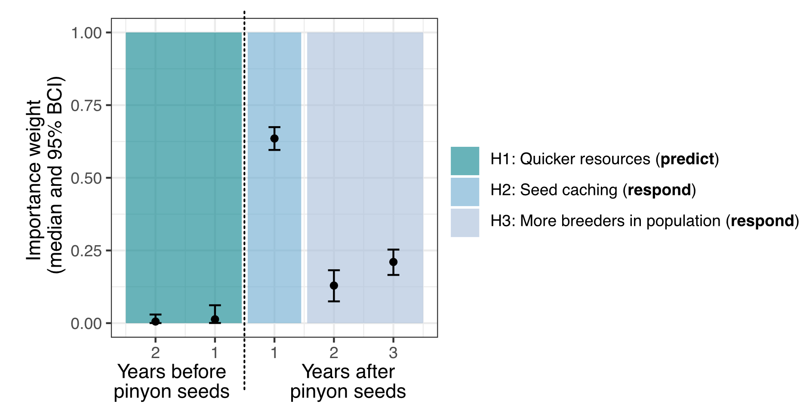
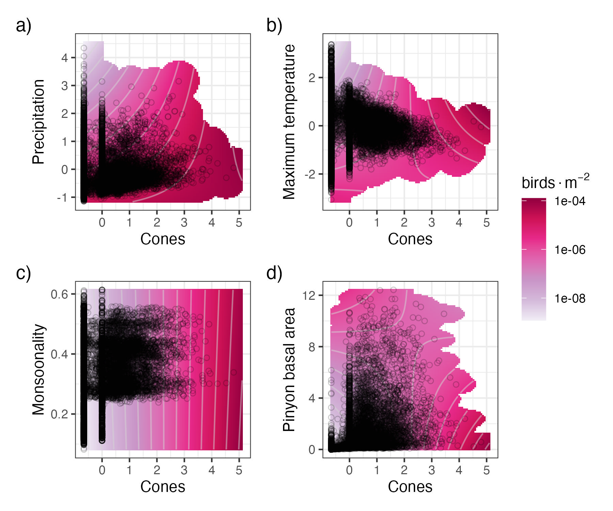
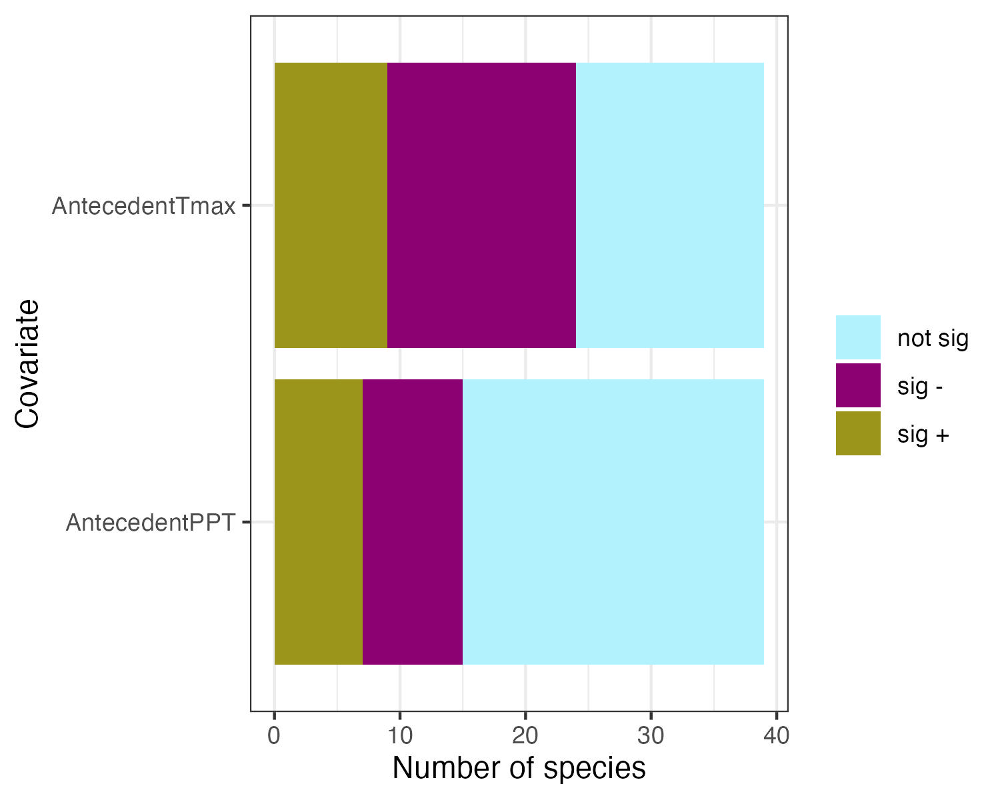
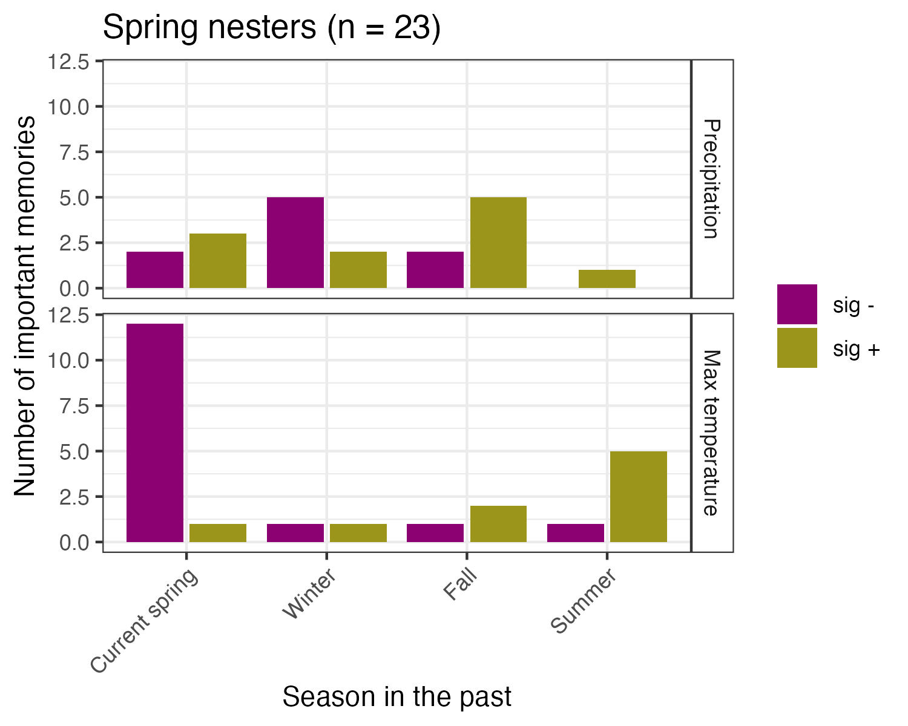
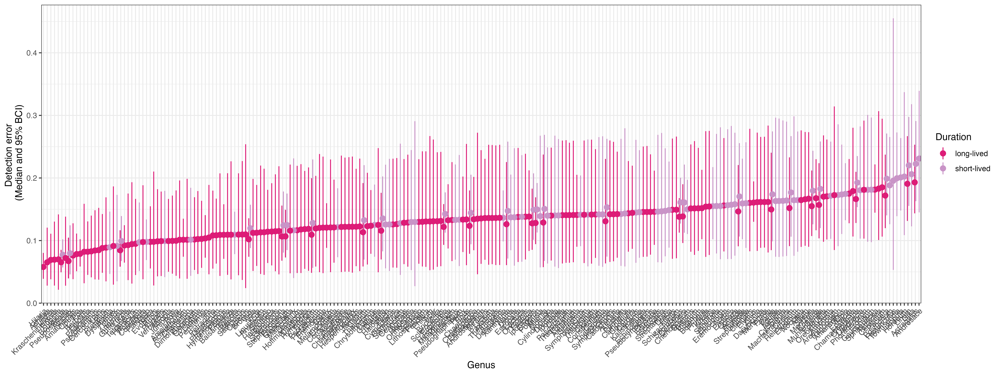
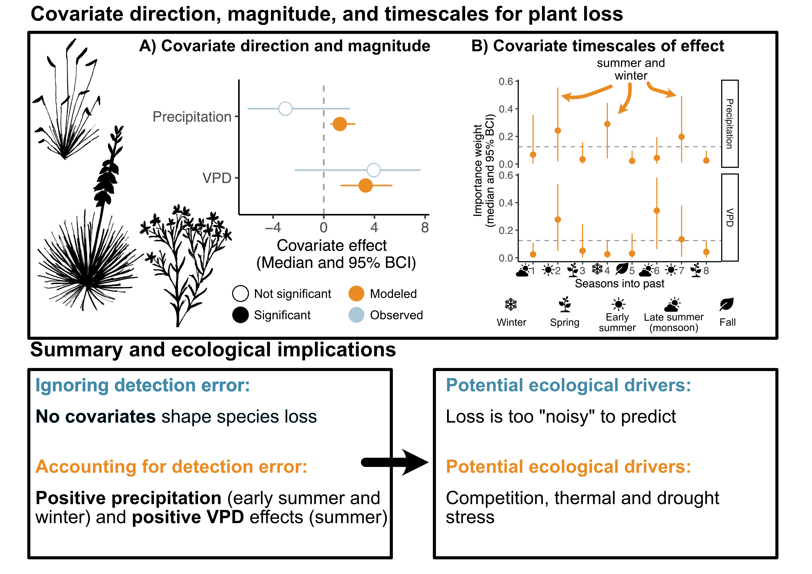

```{r setup, include=FALSE}

if (!require("pacman")) install.packages("pacman")
pacman::p_load(knitr)

knitr::opts_chunk$set(echo = F)
knitr::opts_chunk$set(warning = F)
knitr::opts_chunk$set(message = F)
```

```{=html}
<style>
body {text-align: left}
p.caption {
  font-size: 0.95em;
}
</style>
```

------------------------------------------------------------------------

My research spans a variety of research themes, with my primary focus on understanding species interactions and biodiversity in a changing world. I approach these questions with a variety of approaches, including both theoretical and applied. This page outlines a few of my current research projects and links to my published work by theme. 

## 1. Seed dispersal interaction and a declining bird species

In this project, we are examining relationships between declining pinyon jays and pinyon pine cone production across the Southwest USA. We're combining stochastic antecedent modeling to explore the temporal relationships between bird abundance and seed availability and exploring how climate and habitat context alter the dependency of pinyon jays on pinyon cones. We're using participatory ("citizen") science data from [eBird](https://ebird.org/home) in this project because this dataset has broad temporal and spatial coverage in this region. 

> Pinyon jays are most abundant during the nesting season in locations where they cached seeds in the previous year and there seem to be 3-4 year population effects from seed resource pulses.

```{r, echo=FALSE, out.width = '50%', fig.align='center', fig.cap = "Figure 1: Importance weights of different years of cone availability to the relationship between jay abundance and cones. The strongest effect is the year following cone production, when jays can be found near areas where they cached seeds the previous year. There is also a longer-term population signal of pinyon cone seed resource pulses."}

```

> Pinyon jays rely more on cones during "stressful" climatic events and rely less on cones in more "favorable" habitat conditions. High-quality resources are more important when they are more rare; favorable habitat may increase food source diversity and competition among jays and other species of seed eaters.


```{r, echo=FALSE, out.width = '50%', fig.align='center', fig.cap = "Figure 2: Interaction plots between pinyon cone abundance and climate and habitat covariates for pinyon jay abundance. At high values of precipitation and maximum temperature, birds have stronger relationships with cone availability (a and b). Conversely, at high values of pinyon basal area or monsoonality (how much moisture a site receives during the monsoon season), birds rely less on pinyon cones (c and d)."}

```


------------------------------------------------------------------------

## 2. Climate legacies shape populations and communities

In these projects, we are examining how phenological events are influenced by climatic legacies. For these projects, we are using the [NestWatch](https://nestwatch.org/) dataset from Cornell Lab of Ornithology to dynamically model the effects of antecedent climate, growing degree days, and critical temperature thresholds on when birds lay eggs, when those eggs hatch, and when those hatchlings fledge. 

> Across 39 North American bird species, antecedent temperature and precipitation influence timing of egg-laying.

```{r, echo=FALSE, out.width = '50%', fig.align='center', fig.cap = "Figure 3: The effects of antecedent temperature and precipitation vary in direction across species."}

```

> For spring-nesting bird species, the effects of antecedent precipitation and temperature on the timing of egg laying are shaped by different seasons and depend on whether the effect is negative or positive. Negative effects are shaped by more recent seasonal climate; positive effects are shaped by seasons further in the past.

```{r, echo=FALSE, out.width = '50%', fig.align='center', fig.cap = "Figure 4: Important antecedent seasons shaping spring-nesting birds in North America."}

```

Ongoing work on these projects includes dynamically estimating critical temperatures that lead eggs to hatch earlier or later.

------------------------------------------------------------------------

## 3. Leveraging long-term plant community datasets to understand drought legacies

In this NSF-funded project, we are leveraging data from the National Park Service Inventory and Monitoring Networks to both develop models for long-term data and use these models to understand plant population and community responses to drought. Long-term datasets can inform how communities change through time both in response to perturbations and as a result of underlying community dynamics. However, long-term datasets have a variety of challenges, including changes in protocols and observers through time. Adding to this issue, there is growing recognition that many community datasets are sensitive to imperfect detection, especially of rare species. 

> Detection error (not observing species that are actually there) can be relatively high in community datasets. In plant datasets from the Southwest USA show genus-level detection errors from 6 - 23%. 

```{r, echo=FALSE, out.width = '50%', fig.align='center', fig.cap = "Figure 5: Genus-level detection errors for National Park Service I&M data from the Southern Colorado Plateau Network."}

```

> Imperfect detection can alter whether or not true changes in communities are detected - incorporating detection error shows that plant community species losses are shaped by climatic legacies. 

```{r, echo=FALSE, out.width = '50%', fig.align='center', fig.cap = "Figure 6: Imperfect detection alters whether the effects of precipitation and VPD on plant loss through time are significant (A). Furthermore, this hides the legacy effects of both these variables - with summer and winter precipitation and VPD having multi-year effects on plant loss in communities (B)."}

```

------------------------------------------------------------------------

## 4. Published research themes

#### Forest management impacts forest ecosystems

[Miller-ter Kuile, A. et al. (2026)](pdfs/Miller-terKuile_JAE2026.pdf)

[Miller-ter Kuile, A., et al. (2023)](pdfs/Miller-terKuile_FEM2023.pdf)

[Rodman, K. C., et al. (2024)](pdfs/Rodman_EcoApps2025.pdf)

[Parsons, J. et al. (2021)](pdfs/Parson_FEM2021.pdf)

#### Forest animals as metrics of post-management ecological integrity

[Miller-ter Kuile, A., et al. (2025)](pdfs/Miller-terKuile_FEE2025.pdf)

#### Invasive species and their eradications impact community and ecosystem structure and dynamics

[Preston, D., et al. (2021)](pdfs/Preston_FWE2021.pdf)

[Miller-ter Kuile, A., et al. (2020)](pdfs/Miller-terKuile_Biotropica2020.pdf) 

[Lafferty, K., et al. (2018)](pdfs/Lafferty_BL2018.pdf)

[Nigro, K., et al. (2017)](pdfs/Nigro_RE2017.pdf)

[Young, H., et al. (2017)](pdfs/Young_CJZ2017.pdf)

#### Long-term datasets and statistical techniques for tracking biodiversity change

[Miller-ter Kuile, A. et al. (2025)](pdfs/Miller-terKuile_GCB2025.pdf)

[Hardesty-Moore, M., et al. (2018)](pdfs/Hardesty-Moore_PTB2018.pdf)

#### Food webs are shaped by ecosystem productivity and traits

[Miller-ter Kuile, A., et al. (2022)](pdfs/Miller-terKuile_BL2022) 

[Miller-ter Kuile, A., et al. (2022)](pdfs/Miller-terKuile_Ecology2022.pdf)

[Young, H., et al. (2013)](pdfs/Young_Ecology2013.pdf) 

------------------------------------------------------------------------
